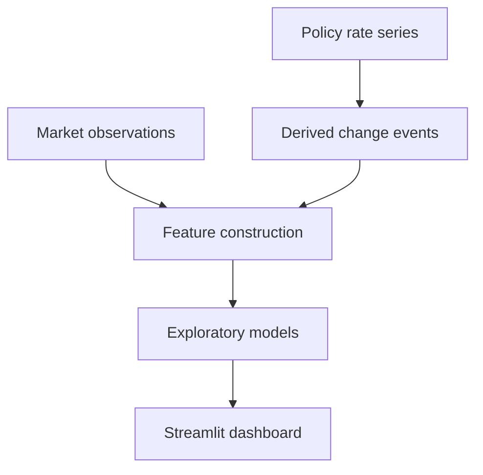

# FOMC bank-stock dashboard

An exploratory team project connecting monetary policy changes with bank-stock behavior.

[Read the case study](CASE_STUDY.md) · [Research pipeline](#research-pipeline) · [Publication scope](PUBLICATION.md)

## The research question

How can policy changes be organized into a study of market behavior, and what can that study reasonably claim?

The original DATA Club project combines an event-study pipeline, feature construction, machine learning models, exploratory analysis, and a Streamlit interface. Its engineering is best understood alongside the timing and validation limits of the research.

**Original team:** Isaac Toffel, Alan Chau, Julian Antropow de la Hoz, and Lucas Azout.

## Research pipeline

The event construction derives policy changes from the rate series. It does not include every policy meeting, so it should not be described as a complete meeting calendar.

## Why timing matters

| Research boundary | Consequence |
| --- | --- |
| Rate changes define events | Meetings without a change are not represented by that event construction. |
| Windows use trading days | The interpretation needs to reflect the market calendar. |
| Related observations can cross validation splits | Shuffled evaluation can leak information between groups. |
| Features can be measured after an announcement | Those features cannot establish a prediction made before the announcement. |

These are limits on the conclusion, rather than details to hide beneath a model result. The project is exploratory research and makes no forecasting, performance, or trading-profit claim here.

## What to inspect

The [case study](CASE_STUDY.md) follows the relationship between event construction, feature timing, evaluation, and presentation. It also distinguishes the original implementation from the validation work that would strengthen the study.

## Attribution and scope

The original team attribution is preserved. AI assisted with additional checks and documentation; that assistance is separate from authorship of the original team project.

Original source, notebooks, chart outputs, license records, and development history remain private. This public repository contains architecture and research-method discussion, without financial results or a runnable deployment. [Publication policy](PUBLICATION.md)
